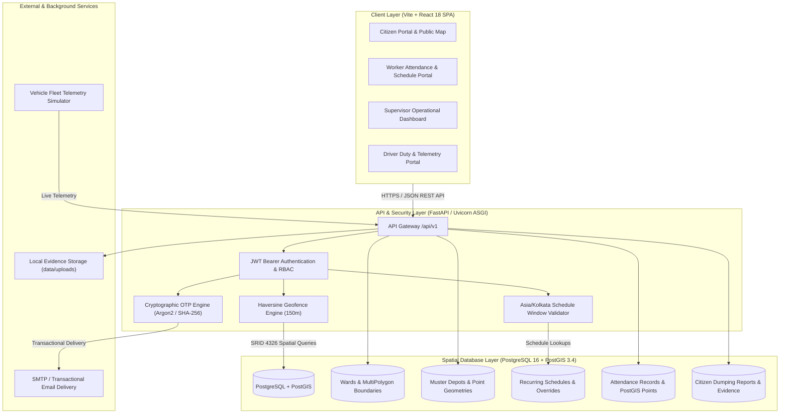

# NammaClean (ನಮ್ಮಕ್ಲೀನ್)

> **Evidence-Based Municipal Solid Waste & Workforce Management Platform for Bengaluru**

NammaClean is a full-stack, civic-tech municipal solid waste management and workforce monitoring platform. It bridges the operational divide between citizens, sanitation workers (*Pourakarmikas*), ward supervisors, and municipal administrators by replacing manual, untracked waste management practices with real-time spatial intelligence, cryptographically verified roll-call attendance, and transparent grievance redressal.

---

## Table of Contents

- [Problem Statement](#problem-statement)
- [Live Deployments](#live-deployments)
- [Key Features by Role](#key-features-by-role)
- [Visual Overview](#visual-overview)
- [System Architecture](#system-architecture)
- [Technology Stack](#technology-stack)
- [Prerequisites](#prerequisites)
- [Local Setup & Installation](#local-setup--installation)
- [Environment Configuration](#environment-configuration)
- [Database Migrations & Seeding](#database-migrations--seeding)
- [Running Locally](#running-locally)
- [API Documentation](#api-documentation)
- [Automated Testing](#automated-testing)
- [Security & Data Integrity](#security--data-integrity)
- [Operational Pilot Scope & Current Limitations](#operational-pilot-scope--current-limitations)
- [Future Roadmap](#future-roadmap)
- [Contributing](#contributing)
- [License & Attributions](#license--attributions)

---

## Problem Statement

Rapid urbanization across Bengaluru generates thousands of metric tonnes of municipal solid waste daily, leading to acute civic and administrative challenges:

1. **Citizen Uncertainty:** Citizens lack real-time visibility into primary waste collection vehicle arrival times, leading to uncollected garbage and open dumping.
2. **Chronic Blackspots:** Illegal dumping sites (*Garbage Vulnerable Points - GVPs*) recur across vacant plots and street corners without a verifiable spatial audit trail of cleanup actions.
3. **Roll-Call Fraud & Disconnected Workforce:** Sanitation workers (*Pourakarmikas*) traditionally rely on manual paper registers for roll call, creating risks of attendance fraud, unverified field presence, and untracked muster depot roll-calls.
4. **Rigid Schedule Oversight:** Ward supervisors lack digital tools to assign, adjust, or override worker shifts and inspect out-of-geofence attendance exceptions in real time.

NammaClean resolves these challenges through an integrated system linking spatial PostGIS geometries, geofenced OTP roll-call attendance, vehicle fleet tracking, and photographic grievance lifecycle management.

---

## Live Deployments

| Component | URL | Status / Platform |
| :--- | :--- | :--- |
| **Web Application (SPA)** | [https://namma-clean.vercel.app](https://namma-clean.vercel.app) | Production Frontend on Vercel |
| **API Documentation (Swagger UI)** | [https://nammaclean-backend.onrender.com/docs](https://nammaclean-backend.onrender.com/docs) | Interactive OpenAPI Docs on Render |
| **API Documentation (ReDoc)** | [https://nammaclean-backend.onrender.com/redoc](https://nammaclean-backend.onrender.com/redoc) | Structured Reference Docs on Render |
| **API Health Check** | [https://nammaclean-backend.onrender.com/api/v1/health/live](https://nammaclean-backend.onrender.com/api/v1/health/live) | Operational Health Endpoint |

---

## Key Features by Role

### 1. Citizen Portal
- **Interactive Ward Map:** View ward boundaries, waste collection routes, scheduled pickup stops, and vehicle positions on an interactive Leaflet map.
- **Illegal Dumping Reporting:** Submit reports for blackspots with GPS coordinates, locality selection, textual description, and photographic evidence (up to 5MB, JPEG/PNG/WebP).
- **Report Lifecycle Tracking:** Real-time visibility into grievance progress (`UNDER_REVIEW` → `ACTION_SCHEDULED` → `RESOLVED` / `REJECTED`) complete with administrative notes and resolution timestamps.
- **Account Management:** User registration, session persistence with secure tokens, and personal report history.

### 2. Sanitation Worker Portal (*Pourakarmikas*)
- **Geofenced Roll-Call Attendance:** Check in at assigned muster depots using a two-factor verification flow: a single-use 6-digit OTP delivered via email (or dev verification card) coupled with device GPS coordinates verified against a 150-meter muster depot geofence.
- **Live Check-In Window Indicators:** Real-time visual cards displaying check-in window state (`ON_TIME`, `GRACE`, `LATE_EXCEPTION`, or `NOT_OPEN`).
- **Weekly Shift Schedules:** View active recurring schedule details, weekly workdays (Mon–Sun), shift hours (e.g., 07:00–14:00 IST), and approved date-specific overrides (holidays, leaves, special shifts).
- **Collection Route Information:** Inspect assigned waste collection routes, sequential collection stop coordinates, and duty route maps.
- **Attendance History & Checkout:** Record shift completion and inspect historical attendance statuses (`PRESENT`, `EXCEPTION_PENDING`, `REJECTED`).

### 3. Ward Supervisor & Municipal Admin Portal
- **Ward Operational Summary:** Live operational metrics displaying scheduled workers, verified present staff, pending attendance, and active field exceptions.
- **Workforce Management:** Register sanitation workers, toggle account status (`ACTIVE` / `DISABLED`), and associate workers with specific BBMP wards.
- **Recurring Schedule Assignment:** Configure shift hours, check-in windows, permitted grace periods, and active weekdays per worker.
- **Date-Specific Schedule Overrides:** Grant single-day leaves, public holidays, or emergency shifts without modifying weekly recurring templates.
- **Attendance Exception Review Queue:** Review and approve or reject check-ins submitted outside depot geofences or outside permitted time windows.
- **Grievance Triage & Resolution:** Inspect citizen dumping reports, review uploaded photographic evidence, assign cleanup operations, and transition grievance statuses with audit comments.

### 4. Vehicle Driver Portal
- **Duty Status Management:** Toggle active duty states (`ON_DUTY` / `OFF_DUTY`) linked to specific municipal collection vehicles.
- **Telemetry Transmission:** Broadcast live vehicle GPS coordinates along scheduled waste collection corridors.

---

## Visual Overview


*Figure 1: NammaClean operational montage showing Citizen GIS Map, Ward Supervisor Operations, Sanitation Worker Roll-Call Dashboard, and Complaint Resolution Tracking.*

---

## System Architecture



---

## Technology Stack

### Frontend Application
- **Core Framework:** React 18.3.1 with TypeScript 5.6.3
- **Build Tool:** Vite 5.4.11
- **Client Routing:** React Router DOM 6.28.0 (with SPA deep-link routing via `_redirects` and `vercel.json`)
- **Mapping & GIS:** Leaflet 1.9.4 with OpenStreetMap and Esri satellite tile layers
- **Icons & Styling:** Lucide React 0.460.0 with custom, responsive Tailwind-inspired CSS

### Backend Application
- **Runtime:** Python 3.12 (ASGI)
- **Web Framework:** FastAPI 0.115.6 with Starlette and Uvicorn 0.34.0
- **Validation:** Pydantic 2.10.4 and Pydantic-Settings 2.7.0
- **ORM & Database Driver:** SQLAlchemy 2.0.36 with `asyncpg` (0.30.0) for async API calls and `psycopg2-binary` (2.9.10) for sync migrations
- **Database Migrations:** Alembic 1.14.0
- **Spatial Processing:** GeoAlchemy2 0.17.0 and Shapely 2.0.6 (EPSG:4326 / WGS 84 geometries)
- **Security & Cryptography:** `pwdlib[argon2]` 0.3.1 (Argon2id hashing) and `PyJWT` 2.15.1 (HMAC-SHA256 tokens)
- **Testing:** Pytest 8.3.4, Pytest-Asyncio 0.25.0, and HTTPX 0.28.1

### Infrastructure & Storage
- **Database:** PostgreSQL 16 with PostGIS 3.4
- **Local Dev Database:** Docker container (`postgis/postgis:16-3.4`) mapped to host port `5433`
- **Hosting Platforms:** Vercel (Frontend SPA) and Render (Backend Web Service + Managed PostGIS)

---

## Prerequisites

Before setting up the project locally, ensure you have the following installed:

- **Operating System:** Windows 10/11, macOS, or modern Linux distribution
- **Python:** Version 3.12 or higher ([python.org](https://www.python.org/))
- **Node.js:** Version 20.x LTS or higher and `npm` ([nodejs.org](https://nodejs.org/))
- **Docker Desktop:** Version 24.x or higher with Docker Compose ([docker.com](https://www.docker.com/))
- **Git:** Version 2.40 or higher

---

## Local Setup & Installation

### 1. Clone the Repository
```powershell
git clone https://github.com/prathampoojari13/NammaClean.git
cd NammaClean
```

### 2. Start the Local PostGIS Database Container
Start the PostgreSQL + PostGIS container using Docker Compose:
```powershell
docker compose up -d
```
*Note: The container maps host port `5433` to container port `5432` to prevent collisions with any existing local PostgreSQL service running on port 5432.*

### 3. Setup Python Backend Virtual Environment
```powershell
# Create virtual environment
python -m venv .venv

# Activate virtual environment (Windows PowerShell)
.\.venv\Scripts\Activate.ps1
# On Linux/macOS: source .venv/bin/activate

# Upgrade pip and install dependencies
pip install --upgrade pip
pip install -r requirements.txt
```

### 4. Setup Frontend Dependencies
```powershell
cd frontend
npm install
cd ..
```

---

## Environment Configuration

### Backend Configuration (`.env`)
Copy the template configuration file:
```powershell
Copy-Item .env.example .env
```

Review and adjust the environment variables in `.env` for your local setup:

| Variable | Description | Example / Local Default |
| :--- | :--- | :--- |
| `APP_NAME` | Platform title | `NammaClean` |
| `APP_ENV` | Runtime environment | `development` (use `production` in cloud) |
| `APP_DEBUG` | Verbose debug logging | `true` |
| `API_V1_STR` | API prefix string | `/api/v1` |
| `BACKEND_CORS_ORIGINS` | Permitted client origins | `["http://localhost:3000","http://localhost:5173","http://127.0.0.1:5173"]` |
| `POSTGRES_HOST` | Local database hostname | `localhost` |
| `POSTGRES_PORT` | Local database port | `5433` |
| `POSTGRES_DB` | Database name | `nammaclean_db` |
| `POSTGRES_USER` | Database user | `nammaclean_admin` |
| `POSTGRES_PASSWORD` | Database user password | `<your_local_password>` |
| `JWT_SECRET_KEY` | Secret key for JWT signing | `<generate_via_python_secrets>` |
| `JWT_ALGORITHM` | Algorithm for token signatures | `HS256` |
| `ACCESS_TOKEN_EXPIRE_MINUTES` | Token validity duration | `30` |
| `SIMULATION_ENABLED` | Simulated fleet movements | `false` |
| `EVIDENCE_STORAGE_PATH` | Evidence file upload folder | `data/uploads/evidence` |
| `PILOT_WARD_CODE` | Anchor municipal pilot ward | `BBMP-W004` |
| `SMTP_HOST` | *(Optional)* SMTP mail server | e.g. `smtp.gmail.com` |
| `SMTP_PORT` | *(Optional)* SMTP mail port | `587` |
| `SMTP_USER` | *(Optional)* SMTP username | `<smtp_email_address>` |
| `SMTP_PASSWORD` | *(Optional)* SMTP App Password | `<smtp_app_password>` |

> [!WARNING]
> Never commit `.env` or files containing database passwords, SMTP credentials, or JWT secrets to Git. The `.gitignore` file is configured to exclude all `.env` files.

### Frontend Configuration (`frontend/.env`)
Create `frontend/.env` to configure the API base URL:
```env
VITE_API_BASE_URL=http://localhost:8000/api/v1
```

---

## Database Migrations & Seeding

### 1. Run Alembic Migrations
Apply database schema migrations to initialize PostGIS spatial extensions, tables, foreign keys, and indexes:
```powershell
.\.venv\Scripts\python.exe -m alembic upgrade head
```

### 2. Seed Initial Pilot Ward & Route Data
Populate the database with authentic geographic boundaries for Ward 4 (Yelahanka Satellite Town & Avalahalli Corridor), muster points, and sample collection routes:
```powershell
.\.venv\Scripts\python.exe scripts/seed_yelahanka_pilot.py
```

### 3. (Optional) Provision Pilot Sanitation Worker
To provision or verify the pilot worker account (`pratikgokavi2007@gmail.com`) idempotently:
```powershell
# Perform a non-destructive dry run:
.\.venv\Scripts\python.exe scripts/provision_pilot_worker.py --dry-run

# Execute live provisioning against local database:
.\.venv\Scripts\python.exe scripts/provision_pilot_worker.py
```

---

## Running Locally

Run both the backend and frontend servers simultaneously in separate terminal windows:

### Terminal 1: Backend API Server
```powershell
.\.venv\Scripts\python.exe -m uvicorn app.main:app --reload --host 127.0.0.1 --port 8000
```
- API Base URL: `http://127.0.0.1:8000/api/v1`
- Interactive Swagger UI: `http://127.0.0.1:8000/docs`

### Terminal 2: Frontend Vite Development Server
```powershell
cd frontend
npm run dev
```
- Local Application: `http://localhost:5173`

---

## API Documentation

FastAPI automatically generates comprehensive OpenAPI documentation. When the backend is running, access:

- **Swagger UI:** `http://127.0.0.1:8000/docs`
- **ReDoc:** `http://127.0.0.1:8000/redoc`
- **OpenAPI Schema:** `http://127.0.0.1:8000/api/v1/openapi.json`

### Core Route Groups
| Endpoint Prefix | Description | Access / Roles |
| :--- | :--- | :--- |
| `/api/v1/auth` | User registration, login, logout, and token refresh | Public |
| `/api/v1/users/me` | Current authenticated user profile | Authenticated |
| `/api/v1/wards` | Ward boundaries, polygons, and spatial metadata | Public / Authenticated |
| `/api/v1/public/map` | Public collection vehicle summaries and route coordinates | Public |
| `/api/v1/reports` | Citizen dumping reports, photo evidence, and status tracking | Citizen / Supervisor |
| `/api/v1/attendance` | Roll-call OTP requests, OTP verification, and check-in | Sanitation Worker |
| `/api/v1/worker` | Worker schedules, route stop sequences, and check-out | Sanitation Worker |
| `/api/v1/supervisor` | Workforce roster, shift scheduling, overrides, and stats | Ward Supervisor / Admin |
| `/api/v1/drivers` | Driver shift duty states and vehicle telemetry ingestion | Driver |
| `/api/v1/health` | Service liveness (`/health/live`) and readiness (`/health/ready`) | Public / Monitoring |

---

## Automated Testing

The project maintains extensive automated test suites covering backend API contracts, geospatial calculations, and frontend behavior.

### Running Backend Unit & Regression Tests (424 Tests)
```powershell
.\.venv\Scripts\python.exe -m pytest -v
```

### Running Specific Provisioning & Schedule Tests
```powershell
# Pilot worker provisioning test suite (8 tests)
.\.venv\Scripts\python.exe -m pytest tests/test_provision_pilot_worker.py -v

# Schedule assignment and attendance window audit suite (11 tests)
.\.venv\Scripts\python.exe -m pytest tests/test_worker_schedule_attendance.py tests/test_attendance_window_boundary_audit.py -v
```

### Running Frontend Contract Tests (52 Tests)
```powershell
npm test --prefix frontend
```

### Verifying Frontend Production Build
```powershell
npm run build --prefix frontend
```

---

## Security & Data Integrity

- **Password Hashing:** Uses `Argon2id` via `pwdlib` with mandatory 12 to 128 character password validation. Plain-text passwords and hashes are never logged.
- **Stateless Authentication:** JSON Web Tokens (JWT) signed with HMAC-SHA256 containing expiration claims (`exp`), subject claims (`sub`), and role claims.
- **Role-Based Access Control (RBAC):** Strict endpoint-level authorization enforcing role boundaries (`CITIZEN`, `SANITATION_WORKER`, `WARD_SUPERVISOR`, `MUNICIPAL_ADMIN`, `DRIVER`).
- **Geofence Enforcement:** Coordinates use standard WGS 84 (`SRID 4326`). Proximity to muster depot roll-call points is computed using the spherical Haversine formula against a strict 150-meter threshold.
- **Roll-Call OTP Security:** 6-digit roll-call OTP challenges are single-use, cryptographically verified, and expire after 5 minutes. In development, OTP is visible on the verification card; in production, delivery is routed via transactional email.
- **Daily Attendance Uniqueness:** The system enforces strict single-check-in rules per worker per calendar day in the `Asia/Kolkata` timezone, preventing duplicate attendance records.
- **Atomic Transactions:** Database operations are wrapped in transactional sessions with automatic rollback on errors or constraint conflicts.

---

## Operational Pilot Scope & Current Limitations

1. **Pilot Area Anchor:**
   The current spatial models, muster points, and collection routes are calibrated for the **Yelahanka Satellite Town & Avalahalli Corridor** (Ward 4, around the BMSIT&M campus perimeter). Broader Bengaluru queries utilize bounding extents for the BBMP municipal region.
2. **Simulated Telemetry:**
   Vehicle fleet telemetry in the public map is generated by an internal simulation engine calibrated to municipal waste collection route patterns. Integration with live AIS-140 GPS hardware units on physical compactor vehicles is planned for Phase 2.
3. **Single-Day Shifts:**
   Shift schedules and check-in windows currently require both start and end times to fall within the same calendar day (between `00:00` and `23:59`). Overnight shifts crossing midnight are not currently supported.
4. **Attendance Uniqueness:**
   A sanitation worker can submit one check-in per calendar day. Once checked in, subsequent check-in attempts on the same workday will return a duplicate attendance conflict (HTTP 409).

---

## Future Roadmap

- [ ] **AIS-140 GPS Device Integration:** Direct ingestion of hardware GPS telemetry from BBMP auto-tippers and compactors over TCP/MQTT.
- [ ] **Automated Route Optimization:** Dynamic route generation based on seasonal waste load density and road network impedance using pgRouting.
- [ ] **Native Mobile Applications:** Dedicated Android/iOS apps for field sanitation workers with offline attendance caching and biometric roll call.
- [ ] **Citizen Push Notifications:** Automated proximity alerts notifying residents 10 minutes prior to a collection vehicle reaching their street.

---

## Contributing

Contributions, bug reports, and suggestions are welcome!

1. Fork the repository.
2. Create your feature branch (`git checkout -b feature/civic-enhancement`).
3. Ensure all tests pass:
   ```powershell
   .\.venv\Scripts\python.exe -m pytest
   npm test --prefix frontend
   npm run build --prefix frontend
   ```
4. Commit your changes with clear, descriptive commit messages (`git commit -m 'feat: add route stop completion metric'`).
5. Push to the branch (`git push origin feature/civic-enhancement`).
6. Open a Pull Request.

---

## License & Attributions

### License
*The license for this repository has not yet been specified.* All rights are reserved by the repository authors pending official licensing.

### Photographic & Media Attributions
- The Vidhana Soudha (Bengaluru) photograph used for the citizen dashboard banner and authentication backdrop is by **iMahesh** and is licensed under [CC BY-SA 4.0](https://creativecommons.org/licenses/by-sa/4.0/).
  - Source: [Vidhana Soudha (Bengaluru) - Panoramic view](https://commons.wikimedia.org/wiki/File:Vidhana_Soudha_(Bengaluru)_-_Panoramic_view.jpg)
  - Asset Paths: `frontend/public/assets/vidhana-soudha-bengaluru.jpg` and `frontend/public/assets/vidhana-soudha-login.jpg`
- Institution and brand marks (`bmsit-institution-logo.svg`, `namma-clean-brand-mark.png`) are reserved for academic and pilot project identification.
