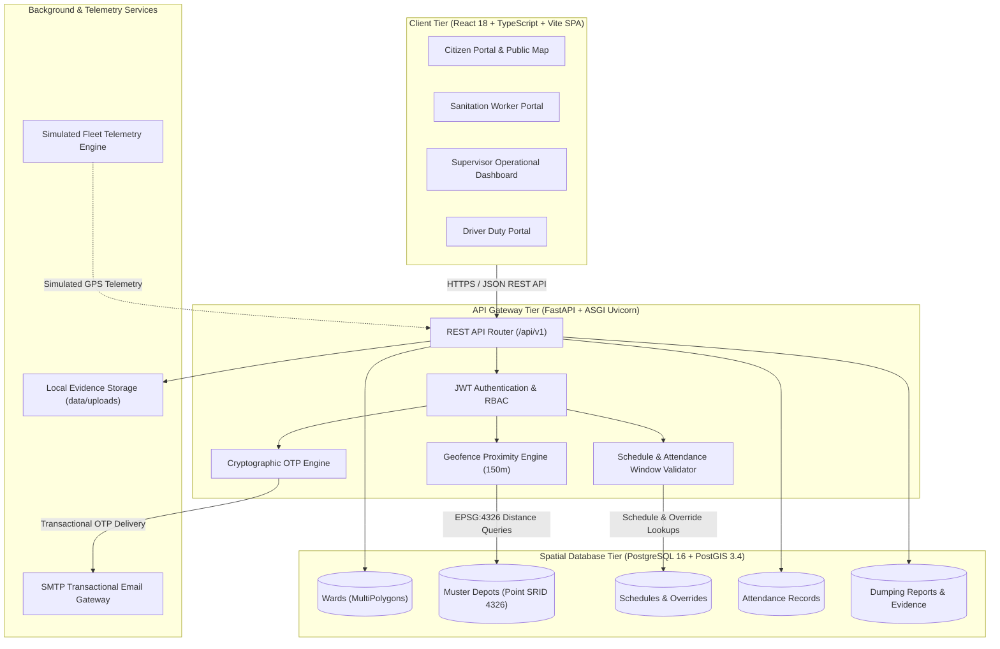

# NammaClean (ನಮ್ಮಕ್ಲೀನ್)

> **Evidence-Based Municipal Solid Waste & Workforce Management Platform for Bengaluru**

[](https://www.python.org/)
[](https://fastapi.tiangolo.com/)
[](https://www.postgresql.org/)
[](https://postgis.net/)
[](https://react.dev/)
[](https://www.typescriptlang.org/)
[](https://vitejs.dev/)
[](https://github.com/prathampoojari13/NammaClean)

NammaClean is a full-stack, civic-tech municipal solid waste management and workforce operations platform designed for Bengaluru. It connects citizens, sanitation workers (*Pourakarmikas*), ward supervisors, and municipal administrators through spatial intelligence, cryptographic roll-call attendance verification, flexible shift scheduling, and evidence-based grievance redressal.

---

## Table of Contents

1. [Project Highlights](#1-project-highlights)
2. [Problem Statement](#2-problem-statement)
3. [Live Deployments](#3-live-deployments)
4. [Key Features by User Role](#4-key-features-by-user-role)
5. [Screenshots and Visual Overview](#5-screenshots-and-visual-overview)
6. [System Architecture Diagram](#6-system-architecture-diagram)
7. [Technology Stack](#7-technology-stack)
8. [Prerequisites](#8-prerequisites)
9. [Local Installation and Setup](#9-local-installation-and-setup)
10. [Environment Configuration](#10-environment-configuration)
11. [Database Migrations and Seeding](#11-database-migrations-and-seeding)
12. [Running the Application](#12-running-the-application)
13. [Administrative Pilot Worker Provisioning](#13-administrative-pilot-worker-provisioning)
14. [API Documentation](#14-api-documentation)
15. [Automated Testing](#15-automated-testing)
16. [Security and Data Integrity](#16-security-and-data-integrity)
17. [Current Pilot Scope and Limitations](#17-current-pilot-scope-and-limitations)
18. [Future Roadmap](#18-future-roadmap)
19. [Contributing](#19-contributing)
20. [License and Attributions](#20-license-and-attributions)

---

## 1. Project Highlights

| Dimension | Description |
| :--- | :--- |
| **Civic Grievance Redressal** | Citizens report illegal dumping blackspots (*Garbage Vulnerable Points*) with GPS coordinates and photographic evidence (up to 5MB, binary magic-byte verified). Reports follow a verifiable audit trail (`UNDER_REVIEW` → `ACTION_SCHEDULED` → `RESOLVED` / `REJECTED`). |
| **Geofenced Roll-Call Attendance** | Sanitation workers (*Pourakarmikas*) verify attendance via a two-factor challenge: single-use 6-digit OTP delivery (email in production / dev card in local dev) coupled with GPS proximity verification against a 150-meter muster depot geofence. |
| **Dynamic Shift Scheduling** | Ward supervisors configure weekly recurring shift hours, permitted check-in windows, and grace periods, with support for single-day schedule overrides (`DAY_OFF`, `HOLIDAY`, `LEAVE`, `SPECIAL_SHIFT`). |
| **Spatial Architecture** | PostGIS spatial database (EPSG:4326 WGS 84) storing municipal ward boundary multipolygons, physical muster depot points, and collection routes. |
| **Full-Stack Implementation** | FastAPI ASGI asynchronous backend (Python 3.12) paired with a responsive React 18 / TypeScript single-page application built on Vite and Leaflet GIS mapping. |

---

## 2. Problem Statement

Rapid urbanization across Bengaluru generates thousands of metric tonnes of municipal solid waste daily, leading to acute civic and operational challenges:

1. **Citizen Uncertainty:** Residents lack visibility into waste collection vehicle schedules, routes, and collection stops, contributing to uncollected household waste and open-air dumping.
2. **Chronic Blackspots:** Unmonitored vacant plots and road corners turn into recurring dumping sites (*Garbage Vulnerable Points*) without a traceable mechanism for citizens to submit evidence or track cleanup actions.
3. **Roll-Call Fraud & Attendance Disconnect:** Sanitation workers traditionally rely on manual paper registers for roll call, creating risks of attendance proxy, unverified field presence, and untracked muster depot attendance.
4. **Rigid Schedule Oversight:** Ward supervisors lack digital tools to assign, adjust, or override worker shifts, track attendance exceptions, or view workforce statistics in real time.

NammaClean addresses these issues by uniting spatial GIS geometries, cryptographic OTP attendance verification, vehicle route mapping, and photographic grievance management into a single platform.

---

## 3. Live Deployments

| Component | Target URL | Hosting Platform / Environment |
| :--- | :--- | :--- |
| **Web Application (SPA)** | [https://namma-clean.vercel.app](https://namma-clean.vercel.app) | Production Single-Page App on Vercel |
| **Interactive API Documentation** | [https://nammaclean-backend.onrender.com/docs](https://nammaclean-backend.onrender.com/docs) | OpenAPI Swagger UI on Render |
| **Alternative API Documentation** | [https://nammaclean-backend.onrender.com/redoc](https://nammaclean-backend.onrender.com/redoc) | ReDoc Schema Documentation on Render |
| **API Health Liveness Check** | [https://nammaclean-backend.onrender.com/api/v1/health/live](https://nammaclean-backend.onrender.com/api/v1/health/live) | Operational Health Liveness Probe |
| **API Health Readiness Check** | [https://nammaclean-backend.onrender.com/api/v1/health/ready](https://nammaclean-backend.onrender.com/api/v1/health/ready) | Database & Cache Readiness Probe |

---

## 4. Key Features by User Role

### Citizen Portal
- **Interactive Ward Map:** Explore municipal ward boundaries, waste collection routes, scheduled pickup stops, and simulated vehicle positions on an interactive Leaflet map.
- **Illegal Dumping Incident Reporting:** Submit geotagged dumping incident reports with precise browser GPS coordinates, locality selection, textual description, and photo attachments (up to 5 images, max 5MB each).
- **Incident Lifecycle Tracking:** Monitor reported blackspots in real time as supervisors review evidence, schedule cleanup operations, and resolve or reject complaints with administrative audit notes.
- **Citizen Account Dashboard:** User registration, session persistence via resilient localStorage token recovery, and complete personal complaint submission history.

### Sanitation Worker Portal (*Pourakarmikas*)
- **Geofenced Roll-Call Attendance:** Check in at assigned physical muster depots using two-factor verification: a 6-digit single-use OTP (delivered via SMTP transactional email or dev verification card) verified alongside browser GPS coordinates evaluated against a 150-meter muster depot geofence.
- **Real-Time Check-In Window Indicators:** Live status badges informing the worker whether their check-in window is open (`ON_TIME`), within permitted grace (`GRACE`), outside scheduled hours (`LATE_EXCEPTION`), or not yet open (`NOT_OPEN`).
- **Weekly Shift & Schedule Viewer:** Review active recurring shift hours (e.g., 07:00–14:00 IST), scheduled workdays (Mon–Sun), and approved date-specific schedule overrides (e.g., approved leave, public holiday, special emergency shifts).
- **Collection Route Information:** View assigned collection route names, sequential pickup stop coordinates, and coverage routes.
- **Shift Completion (Check-Out):** Record official duty check-out with GPS confirmation and view historical attendance records.

### Ward Supervisor & Municipal Admin Portal
- **Ward Operational Statistics:** Live dashboard metrics displaying scheduled workers today, present workers, pending check-ins, and active field exceptions.
- **Workforce Management:** Register sanitation worker accounts, toggle worker status (`ACTIVE` / `DISABLED`), and manage ward assignments.
- **Recurring Schedule Assignment:** Assign and update recurring shift hours, check-in window start/end times, permitted grace periods, and active weekdays per worker.
- **Date-Specific Schedule Overrides:** Grant single-day leaves, holidays, or emergency shifts without modifying base recurring schedules.
- **Attendance Exception Review Queue:** Review and approve or reject check-ins submitted outside muster depot geofences or outside permitted time windows.
- **Grievance Triage & Resolution:** Inspect citizen dumping reports, review uploaded photographic evidence, assign field teams, and transition complaint statuses with administrative comments.

### Vehicle Driver Portal
- **Driver Duty Status:** Toggle active operational status (`ON_DUTY` / `OFF_DUTY`) linked to specific municipal collection vehicles.
- **Telemetry Transmission:** Transmit device GPS coordinates along designated waste collection corridors.

---

## 5. Screenshots and Visual Overview


*Figure 1: NammaClean operational montage showing Citizen GIS Map, Ward Supervisor Operations, Sanitation Worker Roll-Call Dashboard, and Complaint Resolution Tracking.*

---

## 6. System Architecture Diagram



---

## 7. Technology Stack

### Frontend Architecture
- **Framework & Language:** React 18.3.1 with TypeScript 5.6.3
- **Build Tool:** Vite 5.4.11
- **Client-Side Routing:** React Router DOM 6.28.0 (configured with SPA deep-link routing via `_redirects` and `vercel.json`)
- **Mapping & GIS:** Leaflet 1.9.4 with OpenStreetMap and Esri satellite tile layers
- **Iconography & Styling:** Lucide React 0.460.0 with responsive CSS

### Backend Architecture
- **Runtime & Web Framework:** Python 3.12 (ASGI) with FastAPI 0.115.6 and Uvicorn 0.34.0
- **Validation & Settings:** Pydantic 2.10.4 and Pydantic-Settings 2.7.0
- **ORM & Database Drivers:** SQLAlchemy 2.0.36 with `asyncpg` (0.30.0) for async API calls and `psycopg2-binary` (2.9.10) for sync migrations
- **Schema Migrations:** Alembic 1.14.0
- **Geospatial Processing:** GeoAlchemy2 0.17.0 and Shapely 2.0.6 (EPSG:4326 / WGS 84 geometries)
- **Security & Cryptography:** `pwdlib[argon2]` 0.3.1 (Argon2id hashing) and `PyJWT` 2.15.1 (HMAC-SHA256 tokens)
- **Automated Testing:** Pytest 8.3.4, Pytest-Asyncio 0.25.0, and HTTPX 0.28.1

### Infrastructure & Deployment
- **Database:** PostgreSQL 16 with PostGIS 3.4
- **Local Database Container:** Docker (`postgis/postgis:16-3.4`) mapped to host port `5433`
- **Cloud Hosting:** Vercel (Frontend SPA) and Render (Backend Web Service + Managed PostGIS)

---

## 8. Prerequisites

Ensure you have the following installed before local development:

- **Operating System:** Windows 10/11, macOS, or modern Linux distribution
- **Python:** Version 3.12 or higher ([python.org](https://www.python.org/))
- **Node.js:** Version 20.x LTS or higher and `npm` ([nodejs.org](https://nodejs.org/))
- **Docker Desktop:** Version 24.x or higher with Docker Compose ([docker.com](https://www.docker.com/))
- **Git:** Version 2.40 or higher

---

## 9. Local Installation and Setup

### Step 1: Clone the Repository
```bash
git clone https://github.com/prathampoojari13/NammaClean.git
cd NammaClean
```

### Step 2: Configure Environment Files
Copy the example environment templates before starting containers or applications:

**Windows PowerShell:**
```powershell
Copy-Item .env.example .env
```

**Linux / macOS:**
```bash
cp .env.example .env
```

Create `frontend/.env` to configure the frontend API base URL:
```env
VITE_API_BASE_URL=http://localhost:8000/api/v1
```

### Step 3: Start the Local PostGIS Database Container
Start the PostgreSQL + PostGIS container using Docker Compose:
```bash
docker compose up -d
```
*Note: The container maps host port `5433` to container port `5432` to avoid collisions with any local PostgreSQL service running on standard port 5432.*

### Step 4: Setup Python Backend Environment
**Windows PowerShell:**
```powershell
# Create virtual environment
python -m venv .venv

# Activate virtual environment
.\.venv\Scripts\Activate.ps1

# Upgrade pip and install dependencies
pip install --upgrade pip
pip install -r requirements.txt
```

**Linux / macOS:**
```bash
# Create virtual environment
python3 -m venv .venv

# Activate virtual environment
source .venv/bin/activate

# Upgrade pip and install dependencies
pip install --upgrade pip
pip install -r requirements.txt
```

### Step 5: Setup Frontend Dependencies
```bash
cd frontend
npm install
cd ..
```

---

## 10. Environment Configuration

### Backend Configuration (`.env`)
The `.env` file controls application runtime behavior, database connections, security parameters, and pilot defaults:

| Variable | Description | Local Development Default / Example |
| :--- | :--- | :--- |
| `APP_NAME` | Platform title | `NammaClean` |
| `APP_ENV` | Runtime environment (`development`, `production`, `testing`) | `development` |
| `APP_DEBUG` | Verbose debug logging | `true` |
| `API_V1_STR` | API prefix string | `/api/v1` |
| `BACKEND_CORS_ORIGINS` | Permitted client origins (JSON list or comma-separated) | `["http://localhost:3000","http://localhost:5173","http://127.0.0.1:5173"]` |
| `DATABASE_URL` | Cloud database URL (overrides discrete `POSTGRES_*` settings) | *Unset locally (Render / Supabase provide this)* |
| `POSTGRES_HOST` | Database host (local Docker) | `localhost` |
| `POSTGRES_PORT` | Database port (local Docker) | `5433` |
| `POSTGRES_DB` | Database name | `nammaclean_db` |
| `POSTGRES_USER` | Database user | `nammaclean_admin` |
| `POSTGRES_PASSWORD` | Database user password | `<your_local_password>` |
| `JWT_SECRET_KEY` | Cryptographic secret for signing JWT tokens (min 32 bytes) | `<generate_via_python_secrets>` |
| `JWT_ALGORITHM` | Algorithm for token signatures | `HS256` |
| `ACCESS_TOKEN_EXPIRE_MINUTES` | Token validity duration | `30` |
| `SIMULATION_ENABLED` | Simulated vehicle movement | `false` |
| `VEHICLE_FRESHNESS_MINUTES` | Threshold for vehicle signal freshness | `15` |
| `EVIDENCE_STORAGE_PATH` | Evidence file upload folder | `data/uploads/evidence` |
| `MAX_EVIDENCE_FILE_SIZE_BYTES` | Maximum evidence file size in bytes (5 MB) | `5242880` |
| `PILOT_WARD_CODE` | Anchor municipal pilot ward code | `BBMP-W004` |
| `SMTP_HOST` | *(Optional)* SMTP mail server for production OTP delivery | `smtp.gmail.com` |
| `SMTP_PORT` | *(Optional)* SMTP mail port | `587` |
| `SMTP_USER` | *(Optional)* SMTP username | `<smtp_email_address>` |
| `SMTP_PASSWORD` | *(Optional)* SMTP App Password | `<smtp_app_password>` |

> [!WARNING]
> Never commit `.env` or files containing database passwords, SMTP credentials, or JWT secrets to Git. The `.gitignore` file is configured to exclude all `.env` files.

---

## 11. Database Migrations and Seeding

### 1. Apply Schema Migrations
Run Alembic migrations to apply PostGIS extensions, tables, foreign keys, and indexes:
```bash
# Windows PowerShell
.\.venv\Scripts\python.exe -m alembic upgrade head

# Linux / macOS
python -m alembic upgrade head
```

### 2. Seed Pilot Ward & Route Data
Populate the database with authentic geographic boundaries for Ward 4 (Yelahanka Satellite Town & Avalahalli Corridor), muster depots, demo accounts, and sample collection routes:
```bash
# Windows PowerShell
.\.venv\Scripts\python.exe scripts/seed_yelahanka_pilot.py

# Linux / macOS
python scripts/seed_yelahanka_pilot.py
```

---

## 12. Running the Application

Run both the backend and frontend servers simultaneously in separate terminal windows:

### Terminal 1: Backend API Server
```bash
# Windows PowerShell
.\.venv\Scripts\python.exe -m uvicorn app.main:app --reload --host 127.0.0.1 --port 8000

# Linux / macOS
python -m uvicorn app.main:app --reload --host 127.0.0.1 --port 8000
```
- API Base URL: `http://127.0.0.1:8000/api/v1`
- Interactive OpenAPI Docs: `http://127.0.0.1:8000/docs`

### Terminal 2: Frontend Vite Development Server
```bash
cd frontend
npm run dev
```
- Local Application: `http://localhost:5173`

---

## 13. Administrative Pilot Worker Provisioning

The repository includes a dedicated administrative provisioning tool at `scripts/provision_pilot_worker.py` and its test suite at `tests/test_provision_pilot_worker.py`. It provisions the minimum required pilot data needed for worker login and attendance OTP:
1. Ward 4 (`BBMP-W004`) boundary geometry
2. Active muster depot with 150m geofence radius
3. Sanitation worker account for `pratikgokavi2007@gmail.com` (Official ID: `BBMP-WRK-042`)
4. Active ward assignment
5. Weekly recurring schedule with check-in window

### Safety Architecture of the Provisioning Tool
- **Target Detection & Protection:** The script inspects the database target URL. If it targets a non-local or production database (such as Render, Neon, or AWS RDS), execution aborts immediately unless `--confirm-production` is explicitly passed.
- **Fail-Closed Dry Run:** Running with `--dry-run` performs all lookups, plans actions, and unconditionally rolls back the session (`session.rollback()`), persisting zero rows.
- **Argon2id Policy Enforcement:** Enforces 12–128 character password requirements using `app.core.security.hash_password`.
- **Existing Worker Credential Protection:** If the worker account already exists, their existing password is **preserved untouched** by default. Re-running the script will not overwrite an existing password unless the explicit `--update-password` flag is provided.
- **Idempotency:** Re-running the script against an existing database reuses all existing wards, muster points, assignments, and schedules without duplicating records.

### Usage Examples

```powershell
# 1. Non-destructive dry run against local database (inspect plan only):
.\.venv\Scripts\python.exe scripts/provision_pilot_worker.py --dry-run

# 2. Live provisioning against local database:
.\.venv\Scripts\python.exe scripts/provision_pilot_worker.py

# 3. Non-destructive dry run against a specific cloud/staging database:
.\.venv\Scripts\python.exe scripts/provision_pilot_worker.py --db-url "<DATABASE_URL>" --dry-run

# 4. Live execution against production/cloud database (requires deliberate confirmation):
.\.venv\Scripts\python.exe scripts/provision_pilot_worker.py --db-url "<DATABASE_URL>" --confirm-production
```

---

## 14. API Documentation

FastAPI automatically generates interactive OpenAPI documentation. When the backend server is running, access:

- **Swagger UI:** `http://127.0.0.1:8000/docs`
- **ReDoc:** `http://127.0.0.1:8000/redoc`
- **OpenAPI JSON Schema:** `http://127.0.0.1:8000/api/v1/openapi.json`

### Core Route Groups
| Endpoint Prefix | Description | Auth / Role Scope |
| :--- | :--- | :--- |
| `/api/v1/auth` | User registration, login, logout, and token refresh | Public |
| `/api/v1/users/me` | Current authenticated user profile | Authenticated |
| `/api/v1/wards` | Ward boundaries, polygons, and spatial metadata | Public / Authenticated |
| `/api/v1/public/map` | Public collection vehicle summaries and route coordinates | Public |
| `/api/v1/reports` | Citizen dumping reports, photo evidence, and status tracking | Citizen / Supervisor |
| `/api/v1/attendance` | Roll-call OTP requests, OTP verification, and check-in | Sanitation Worker |
| `/api/v1/worker` | Worker schedules, route stop sequences, and check-out | Sanitation Worker |
| `/api/v1/supervisor` | Workforce roster, shift scheduling, overrides, and stats | Ward Supervisor / Admin |
| `/api/v1/drivers` | Driver shift duty states and vehicle telemetry ingestion | Driver |
| `/api/v1/health` | Service liveness (`/health/live`) and readiness (`/health/ready`) | Public / Monitoring |

---

## 15. Automated Testing

The project maintains comprehensive automated test suites covering backend API contracts, geospatial calculations, and frontend behavior.

### Running Backend Unit & Regression Tests (424 Tests)
```bash
# Windows PowerShell
.\.venv\Scripts\python.exe -m pytest -v

# Linux / macOS
python -m pytest -v
```

### Running Specific Provisioning & Schedule Test Suites
```bash
# Pilot worker provisioning test suite (8 tests)
pytest tests/test_provision_pilot_worker.py -v

# Schedule assignment and attendance window audit suite (11 tests)
pytest tests/test_worker_schedule_attendance.py tests/test_attendance_window_boundary_audit.py -v
```

### Running Frontend Contract Tests (52 Tests)
```bash
npm test --prefix frontend
```

### Verifying Frontend Production Build
```bash
npm run build --prefix frontend
```

---

## 16. Security and Data Integrity

- **Password Hashing:** Uses `Argon2id` via `pwdlib` with mandatory 12 to 128 character password validation. Plain-text passwords and hashes are never logged or returned in API responses.
- **Stateless Authentication:** JSON Web Tokens (JWT) signed with HMAC-SHA256 containing expiration claims (`exp`), subject claims (`sub`), and role claims.
- **Role-Based Access Control (RBAC):** Strict endpoint-level authorization enforcing role boundaries (`CITIZEN`, `SANITATION_WORKER`, `WARD_SUPERVISOR`, `MUNICIPAL_ADMIN`, `DRIVER`).
- **Geofence Enforcement:** Coordinates use standard WGS 84 (`SRID 4326`). Proximity to muster depot roll-call points is computed using the spherical Haversine formula against a strict 150-meter threshold. Out-of-geofence submissions are routed to the supervisor review queue (`EXCEPTION_PENDING`).
- **Roll-Call OTP Security:** 6-digit roll-call OTP challenges are single-use, cryptographically verified, and expire after 5 minutes. In development, OTP is visible on the verification card; in production, delivery is routed via transactional email.
- **Daily Attendance Uniqueness:** The system enforces strict single-check-in rules per worker per calendar day in the `Asia/Kolkata` timezone, preventing duplicate attendance records.
- **Evidence Storage Security:** File uploads enforce a 5MB per-file limit (max 5 photos per report), validate binary magic bytes to prevent extension spoofing, and store files under server-generated UUID filenames to prevent path traversal attacks.
- **Atomic Transactions:** Database operations are wrapped in transactional sessions with automatic rollback on errors or constraint conflicts.

---

## 17. Current Pilot Scope and Limitations

1. **Pilot Area Anchor:**
   The current spatial models, muster points, and collection routes are calibrated for the **Yelahanka Satellite Town & Avalahalli Corridor** (Ward 4, around the BMSIT&M campus perimeter). Broader Bengaluru queries utilize bounding extents for the BBMP municipal region.
2. **Simulated Telemetry:**
   Vehicle fleet telemetry in the public map is generated by an internal simulation engine calibrated to municipal waste collection route patterns. Integration with live AIS-140 GPS hardware units on physical compactor vehicles is planned for Phase 2.
3. **Single-Day Shifts:**
   Shift schedules and check-in windows currently require both start and end times to fall within the same calendar day (between `00:00` and `23:59`). Overnight shifts crossing midnight are not currently supported.
4. **Attendance Uniqueness:**
   A sanitation worker can submit one check-in per calendar day. Once checked in, subsequent check-in attempts on the same workday return a duplicate attendance conflict (HTTP 409).
5. **Municipal Status:**
   NammaClean is an academic civic-technology demonstration and research platform developed at BMSIT&M. It is not an officially endorsed BBMP government deployment.

---

## 18. Future Roadmap

- [ ] **AIS-140 GPS Device Integration:** Direct ingestion of hardware GPS telemetry from BBMP auto-tippers and compactors over TCP/MQTT.
- [ ] **Automated Route Optimization:** Dynamic route generation based on seasonal waste load density and road network impedance using pgRouting.
- [ ] **Native Mobile Applications:** Dedicated Android/iOS apps for field sanitation workers with offline attendance caching and biometric roll call.
- [ ] **Citizen Push Notifications:** Automated proximity alerts notifying residents 10 minutes prior to a collection vehicle reaching their street.

---

## 19. Contributing

Contributions, bug reports, and suggestions are welcome!

1. Fork the repository.
2. Create your feature branch (`git checkout -b feature/civic-enhancement`).
3. Ensure all tests pass:
   ```bash
   pytest
   npm test --prefix frontend
   npm run build --prefix frontend
   ```
4. Commit your changes with clear, descriptive commit messages (`git commit -m 'feat: add route stop completion metric'`).
5. Push to the branch (`git push origin feature/civic-enhancement`).
6. Open a Pull Request.

---

## 20. License and Attributions

### License
*The license for this repository has not yet been specified.* All rights are reserved by the repository authors pending official licensing.

### Photographic & Media Attributions
- The Vidhana Soudha (Bengaluru) photograph used for the citizen dashboard banner and authentication backdrop is by **iMahesh** and is licensed under [CC BY-SA 4.0](https://creativecommons.org/licenses/by-sa/4.0/).
  - Source: [Vidhana Soudha (Bengaluru) - Panoramic view](https://commons.wikimedia.org/wiki/File:Vidhana_Soudha_(Bengaluru)_-_Panoramic_view.jpg)
  - Asset Paths: `frontend/public/assets/vidhana-soudha-bengaluru.jpg` and `frontend/public/assets/vidhana-soudha-login.jpg`
- Institution and brand marks (`bmsit-institution-logo.svg`, `namma-clean-brand-mark.png`) are reserved for academic and pilot project identification.
