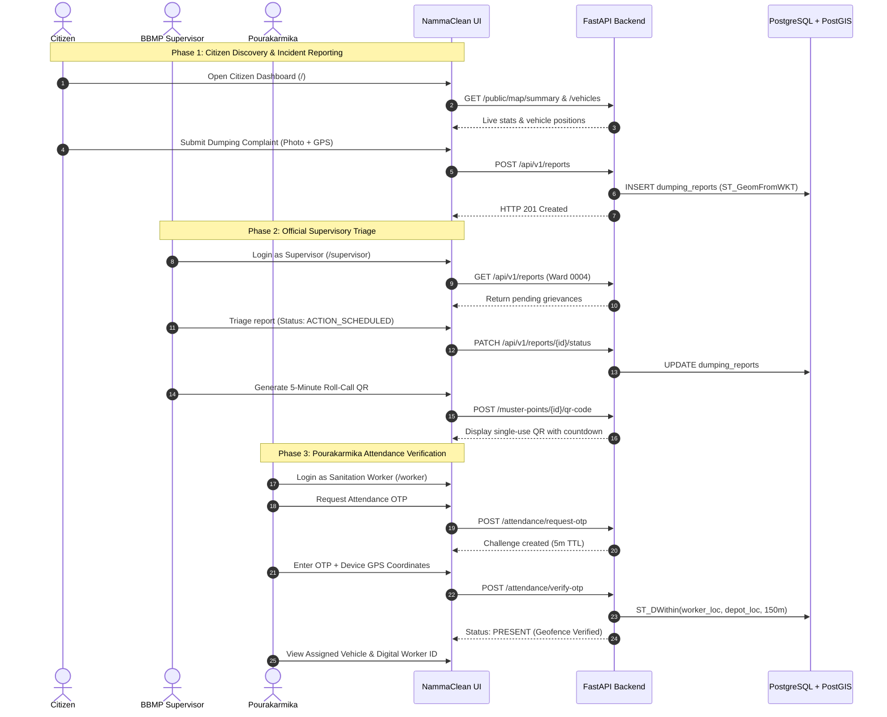

# NammaClean — Live Demonstration Execution Script
**Academic Presentation Guide for Live Project Demonstration**  
**Institution**: BMS Institute of Technology and Management (BMSIT&M), Bengaluru  
**Target URL**: `http://127.0.0.1:5173/` (Frontend) & `http://127.0.0.1:8000/docs` (Backend API)  

---

## 1. Demonstration Setup & Pre-Flight Checklist

Ensure both services are running and healthy before starting the presentation:

| Service | Address | Verification Check | Status |
| :--- | :--- | :--- | :---: |
| **Vite Frontend** | `http://127.0.0.1:5173/` | Open in browser; home page loads with clean console | Running |
| **FastAPI Backend** | `http://127.0.0.1:8000/` | Navigate to `/api/v1/health`; returns `{"status":"healthy","database":"connected"}` | Running |
| **PostgreSQL / PostGIS** | `localhost:5433` | PostGIS extension active, migrations at current head | Connected |

### Pre-Configured Demo Accounts (By Role)
*Do not reveal raw passwords to the audience; credentials are pre-seeded in the database for demonstration:*
* **Citizen Account**: `demo.citizen@nammaclean.local` (Display Name: *Pratham*, Locality: *Yelahanka*)
* **BBMP Official Account**: `supervisor.yelahanka@nammaclean.local` (Role: `WARD_SUPERVISOR`, Ward: *Ward 0004 Yelahanka*)
* **Pourakarmika / Worker Account**: `worker.yelahanka@nammaclean.local` (Role: `SANITATION_WORKER`, Station: *Yelahanka Satellite Town Depot*)

---

## 2. Step-by-Step Demonstration Sequence

---

### Step 1: Project Introduction & Citizen Dashboard Launch
* **Route**: `/` (or click Home from navbar)
* **Action**:
  1. Open browser at `http://127.0.0.1:5173/`.
  2. If an existing session is open, click **Logout** from the top right to show the guest view, then log in using the pre-seeded **Citizen** account.
* **Expected Result**:
  * Dashboard band loads with Vidhana Soudha background image and 5 animated soaring nature birds SVG.
  * Welcome greeting updates dynamically to: **"Welcome Back, Pratham!"** with subtitle *"Together for a cleaner and greener Bengaluru 🌱"*.
  * The 4 original summary cards display live counts:
    * **Active Vehicles** (Live fleet count)
    * **Collection Points** (Published community bins across Bengaluru)
    * **Published Routes** (Active service routes)
    * **Your Reports** (Personal report counter)
* **Speaker Script**:
  > *"We begin on the Citizen Dashboard. Notice the responsive civic design reflecting Bengaluru's identity. Citizens immediately see verified operational summaries derived directly from our PostGIS backend."*

---

### Step 2: Interactive Fleet Map & Telemetry Exploration
* **Route**: `/` (Scroll to `#citizen-map` or click "Track Vehicles" in header)
* **Action**:
  1. Observe the interactive Leaflet map centered on Bengaluru with an operational cluster in Yelahanka.
  2. Toggle between **Standard** (OpenStreetMap) and **Satellite** (Esri World Imagery) view.
  3. Click on an active collection vehicle icon (truck marker).
* **Expected Result**:
  * Map layers switch instantaneously without re-rendering or page reload.
  * Clicking a vehicle marker opens the **Vehicle Details Drawer** showing:
    * Vehicle Registration Number (e.g., `KA-50-P-0401`).
    * Vehicle Type (e.g., *Compactor Truck*).
    * Current Speed and Directional Heading.
    * Last-seen freshness badge (e.g., *Fresh / Live*).
    * Clear badge: **"Simulated Telemetry"** (maintaining complete academic transparency).
* **Speaker Script**:
  > *"Citizens can track primary collection vehicles in real time. We have implemented tile-layer switching between street maps and high-resolution satellite imagery. Every vehicle displays its telemetry freshness and an honest indicator that positions are generated by our internal simulation engine for demonstration stability."*

---

### Step 3: Geotagged Dumping Incident Reporting
* **Route**: `/` (Click "Report Dumping" button in sidebar or header)
* **Action**:
  1. Click **"Report Dumping"**. The modal opens.
  2. In the description field, enter a sample description (e.g., *"Accumulated commercial waste and black spot near Yelahanka Old Town Market"* — ensuring >10 characters).
  3. Click on the mini-map to select coordinates, or accept default GPS coordinates within Yelahanka.
  4. (Optional) Attach a sample image file if available.
  5. Click **"Submit Incident Report"**.
* **Expected Result**:
  * Frontend validates description length (10–1000 characters) and coordinate ranges.
  * Backend issues `HTTP 201 Created` and stores the incident with PostGIS `POINT(longitude latitude)`.
  * Success alert appears: *"Report submitted successfully! BBMP officials will review your grievance."*
  * The *"Your Reports"* summary card increments, and the report appears in the *"My Reports"* tab.
* **Speaker Script**:
  > *"When reporting illegal dumping, input validation is enforced on both client and server. The report is saved with PostGIS spatial coordinates, ensuring it automatically maps to the correct ward supervisor's jurisdiction."*

---

### Step 4: BBMP Official Dashboard & Complaint Review
* **Route**: `/login` -> `/supervisor`
* **Action**:
  1. Click **Logout** from the top right.
  2. Log in using the **BBMP Official** account (`supervisor.yelahanka@nammaclean.local`).
  3. Dashboard redirects automatically to `/supervisor`.
  4. Click the **"Citizen Reports"** tab.
* **Expected Result**:
  * Welcome banner displays: **"BBMP Ward Supervisor — Ward 0004 (Yelahanka)"**.
  * Four operational metric cards display:
    * *Active Vehicles*
    * *Published Routes*
    * *Pending Reports*
    * *Staff on Duty*
  * The complaint submitted in Step 3 appears at the top of the grievance triage table with status `SUBMITTED`.
* **Speaker Script**:
  > *"We now switch to the BBMP Official Dashboard. Notice how role-based routing directs the supervisor to their jurisdiction. The grievance we just logged as a citizen appears immediately in the supervisor's triage queue for Ward 0004."*

---

### Step 5: Complaint Status Transition
* **Route**: `/supervisor` (Tab: Citizen Reports)
* **Action**:
  1. In the complaints table, find the submitted report.
  2. Click the status dropdown and transition from **SUBMITTED** to **ACTION_SCHEDULED** or **UNDER_REVIEW**.
  3. Enter an optional official note (e.g., *"Compactor truck dispatched for clearance at 10:30 AM"*).
  4. Click **"Update Status"**.
* **Expected Result**:
  * Backend processes `PATCH /api/v1/reports/{id}/status`.
  * Status badge updates to purple (`ACTION_SCHEDULED`) with confirmation toast.
  * Audit log persists the supervisor's user ID, timestamp, and official note.
* **Speaker Script**:
  > *"The supervisor updates the status to 'Action Scheduled'. The system records an immutable audit trail. When the citizen next logs in, their personal dashboard reflects this update in real time."*

---

### Step 6: Morning Roll-Call QR Code Generation
* **Route**: `/supervisor` (Tab: Worker Roll-Call)
* **Action**:
  1. Click the **"Worker Roll-Call"** tab.
  2. Select muster station: *"Yelahanka Satellite Town Muster Depot"*.
  3. Click **"Generate 5-Minute Roll-Call QR"**.
* **Expected Result**:
  * Backend issues a cryptographically hashed, single-use QR token with a 300-second time-to-live.
  * Interactive QR code renders on screen with an active visual countdown timer.
  * Explanatory notice states: *"Token expires in 5 minutes. Replay attacks and expired tokens are rejected by the server."*
* **Speaker Script**:
  > *"For depot roll-calls, supervisors can display this dynamic QR code. It features a strict 5-minute cryptographic expiration, preventing workers from sharing static pictures or proxying attendance from off-site."*

---

### Step 7: Operations Attendance Roster Audit
* **Route**: `/supervisor` (Tab: Operations Roster)
* **Action**:
  1. Click the **"Operations Roster"** tab.
  2. Inspect the daily attendance grid.
* **Expected Result**:
  * Roster displays all assigned pourakarmikas for Ward 0004.
  * Shows current status: `NOT CHECKED IN` (or `PRESENT` if previously run).
  * Geofence exception column flags any off-site check-in attempts.
* **Speaker Script**:
  > *"The Operations Roster provides real-time attendance auditing. Once our worker checks in, this table will update automatically to reflect their verified arrival."*

---

### Step 8: Pourakarmika Dashboard & Worker Identity
* **Route**: `/login` -> `/worker`
* **Action**:
  1. Click **Logout** from the top right.
  2. Log in using the **Pourakarmika / Worker** account (`worker.yelahanka@nammaclean.local`).
  3. Dashboard navigates to `/worker`.
* **Expected Result**:
  * Banner displays: **"Sanitation Worker — Pourakarmika Field Portal"**.
  * 4 field cards show:
    * *Muster Depot*: **Yelahanka Satellite Town Muster Depot**
    * *Shift Attendance*: **Not Checked In** (or *Present*)
    * *Assigned Vehicle*: **KA-50-P-0401**
    * *Check-In Time*: Pending
  * Navigation tabs show: *Field Overview*, *Attendance Portal*, *Tasks & Depot*, *Vehicle & Route*, and *Worker ID Card*.
* **Speaker Script**:
  > *"Now we log in as a Pourakarmika. The interface is optimized for field usability, showing the worker's assigned muster station, designated vehicle, and route for the morning shift."*

---

### Step 9: Attendance OTP Verification & Geofence Check-In
* **Route**: `/worker` (Tab: Attendance Portal)
* **Action**:
  1. Click the **"Attendance Portal"** tab.
  2. Click **"Request Attendance OTP"**.
  3. Observe server output or check `scratch/dev_latest_otp.txt` for the 6-digit code (e.g., `482915`).
  4. Allow browser GPS permission prompt (or accept coordinates pre-populated within Yelahanka depot).
  5. Enter the 6-digit OTP into the input box and click **"Verify OTP & Check In"**.
* **Expected Result**:
  * Backend verifies salted SHA-256 OTP hash and runs PostGIS `ST_DWithin` spatial query against Yelahanka Depot coordinates.
  * Check-in succeeds with `HTTP 200`. Status badge changes to bright green: **"PRESENT (Geofence Verified)"**.
  * Timestamp is recorded. The **"Shift Check-Out"** button becomes active.
* **Speaker Script**:
  > *"The worker requests an OTP. In our local test environment, the code is printed to our development logger. We submit the OTP alongside device GPS. PostGIS verifies that the worker is physically within 150 meters of the Yelahanka depot, marking attendance as verified."*

---

### Step 10: Shift Check-Out & Digital Worker ID Card
* **Route**: `/worker` (Tabs: Attendance Portal & Worker ID Card)
* **Action**:
  1. (Optional) Click **"Check Out of Shift"** to show shift completion and duration recording.
  2. Click the **"Worker ID"** tab.
* **Expected Result**:
  * Digital identity card renders displaying:
    * Worker Full Name and Employee ID.
    * Assigned Ward: *Ward 0004 (Yelahanka)*.
    * Designated Muster Station: *Yelahanka Satellite Town Depot*.
    * Official NammaClean civic verification watermark.
* **Speaker Script**:
  > *"At shift completion, workers check out to log their hours. The digital identity card provides verified Pourakarmikas with proof of municipal assignment and dignity of labor."*

---

### Step 11: Summary & Technical Transition
* **Action**: Conclude the live demonstration and transition back to presentation slides for architecture, security, and technical Q&A.
* **Speaker Script**:
  > *"This concludes our live operational demonstration, illustrating an accountable loop connecting Citizen, Supervisor, and Pourakarmika. We now return to our presentation to discuss our system architecture, security benchmarks, and future roadmap."*

---

## 3. Contingency & Recovery Guide

| Failure Scenario | Immediate Detection | Rapid Recovery Action |
| :--- | :--- | :--- |
| **Accidental Logout or Session Expiry** | 401 Unauthorized redirect to `/login` | Click the quick demo account buttons on the `/login` page to re-authenticate immediately in one click. |
| **Browser GPS Permission Blocked** | Geolocation error message appears in worker tab | The UI includes pre-configured fallback coordinates for the Yelahanka depot to prevent demonstration stalls when GPS hardware is absent. |
| **OTP Entry Error or Expiry** | *"Invalid or expired OTP code"* alert | Click *"Request New OTP"*; check the latest code in `scratch/dev_latest_otp.txt` and submit within 5 minutes. |
| **Map Satellite Tiles Slow to Load** | Gray grid squares on satellite view | Toggle the tile switcher in the top right of the map back to **Standard Map** (uses cached OpenStreetMap vector tiles). |
| **FastAPI Backend Not Responding** | Console network errors to `localhost:8000` | Verify the terminal running `uvicorn app.main:app` is active; backend health can be validated in 2 seconds at `http://127.0.0.1:8000/api/v1/health`. |
